# Red-Black Raytraced World

> Dos mundos. Un portal. Un diorama de voxels trazado por completo en la CPU.

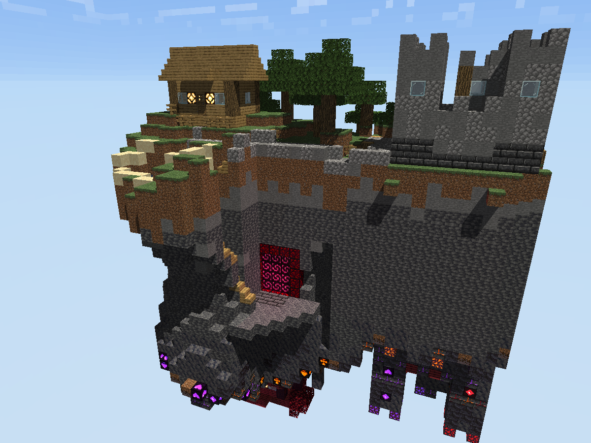

Una isla flotante bajo un cielo de nubes, con una casa, un estanque y un castillo. En su costado,
tallado en la roca, un portal carmesí. Crúzalo y el mundo se da la vuelta: la misma isla vista
desde abajo es un segundo mundo, oscuro e invertido, donde una fortaleza de cuatro torres cuelga
del techo y los palos de la baraja brillan dentro de la piedra.

Cada píxel es un rayo trazado en Rust sobre la CPU, sin ninguna biblioteca que renderice la escena
por nosotros.

**Ir a:** [Los dos mundos](#explora-los-dos-mundos) · [Ejecutarlo](#ejecuta-el-proyecto) ·
[Controles](#controles) · [Materiales](#materiales-que-transforman-la-luz) ·
[Ray tracing](#el-ray-tracer-por-dentro) · [Rendimiento](#de-segundos-por-frame-a-un-mundo-explorable) ·
[Rúbrica](#cobertura-de-la-rúbrica) · [Arquitectura](#arquitectura-y-decisiones-de-ingeniería)

---

## ¿Qué es Red-Black Raytraced World?

Es un pequeño diorama de voxels inspirado en Minecraft, creado para el curso de Gráficas por
Computadora de la Universidad del Valle de Guatemala, junto con el ray tracer escrito desde cero
para renderizarlo.

- **Un mundo, dos reinos.** Una sola cuadrícula de voxels contiene el luminoso Overworld y el
  mundo invertido Red-Black. Son las dos caras del mismo diamante flotante.
- **Un portal físico.** Los dos mundos se unen por una abertura real que se atraviesa volando. Al
  cruzarla, la cámara gira 180°, el "arriba" se invierte y el cielo cambia.
- **Un ray tracer por CPU.** Un rayo por píxel, un DDA 3D a través de la cuadrícula, cubos
  texturizados y formas parciales, sombras, reflexión, refracción, normal maps, materiales
  emisivos y un skybox cubemap.
- **Explorable.** El render paralelo y una vista previa adaptativa lo mantienen interactivo, y la
  colisión permite recorrer los caminos y entrar en los edificios.

| | |
|---|---|
| Tamaño del mundo | 9,633 voxels, 45 tipos de bloque |
| Texturas | 95 archivos PNG, todos muestreados nearest-neighbor en la CPU |
| Luces | 1 sol direccional, 4 luces puntuales (el portal y las tres familias Red-Black) |
| Pruebas | 1,932 superadas |

---

## Explora los dos mundos

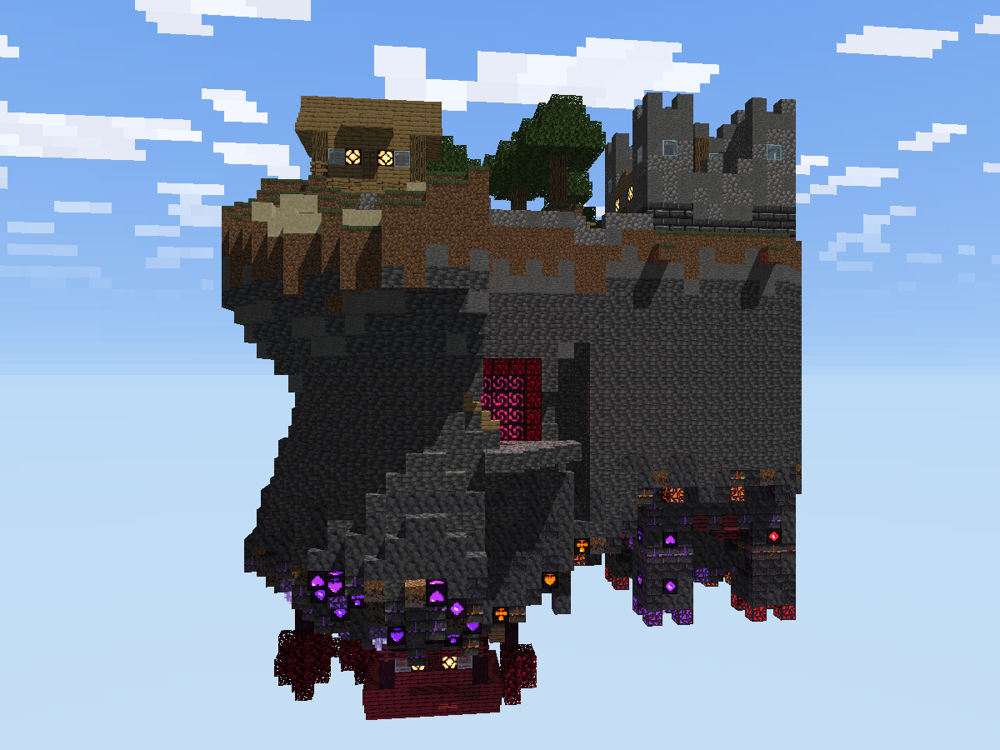

La isla está abierta por un costado para que se lea como un corte transversal: pasto y tierra
arriba, piedra y deepslate debajo, el portal a media altura y el mundo Red-Black creciendo hacia
abajo desde la cara inferior.

### Overworld

<table>
<tr>
<td width="50%">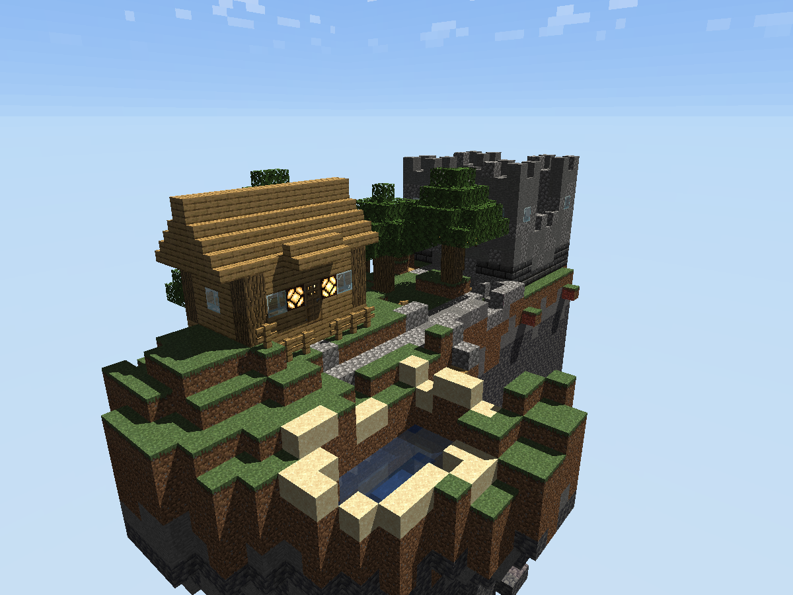</td>
<td width="50%">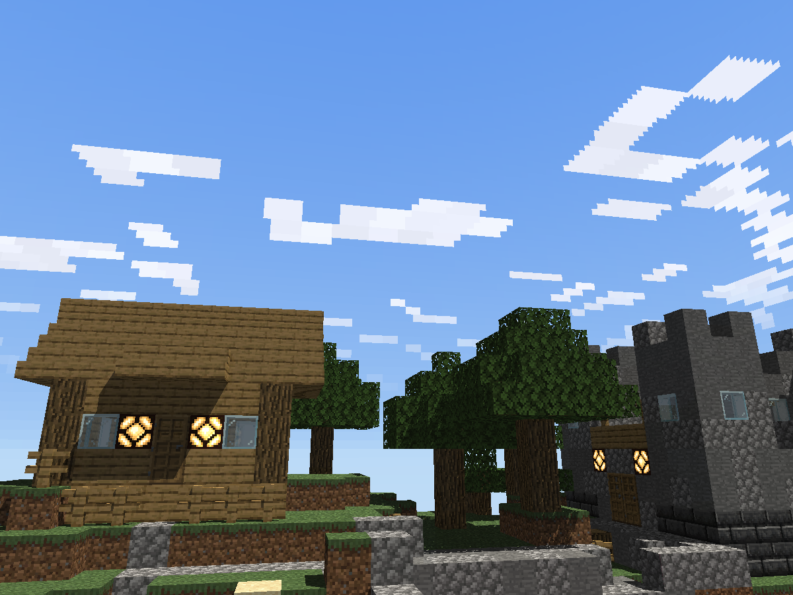</td>
</tr>
</table>

La mitad luminosa. Todo aquí se asienta sobre terreno generado proceduralmente.

- **Terreno** — un relieve ondulado hecho con ruido fractal, con estratos de pasto, tierra, piedra
  y deepslate expuestos en los flancos de la isla.
- **Casa** — paredes de madera, postes de tronco en las esquinas, un techo escalonado, ventanas de
  vidrio y dos lámparas encendidas junto a la puerta.
- **Estanque** — agua refractiva en una hondonada de arena.
- **Árboles y caminos** — copas de hojas con follaje recortado y un camino de piedra de la casa al
  castillo.
- **Castillo** — una torre de piedra con almenas, un interior amueblado y una escalera.
- **Cielo** — un cubemap de nubes con el sol justo donde nace la luz de la escena.

<table>
<tr>
<td width="50%">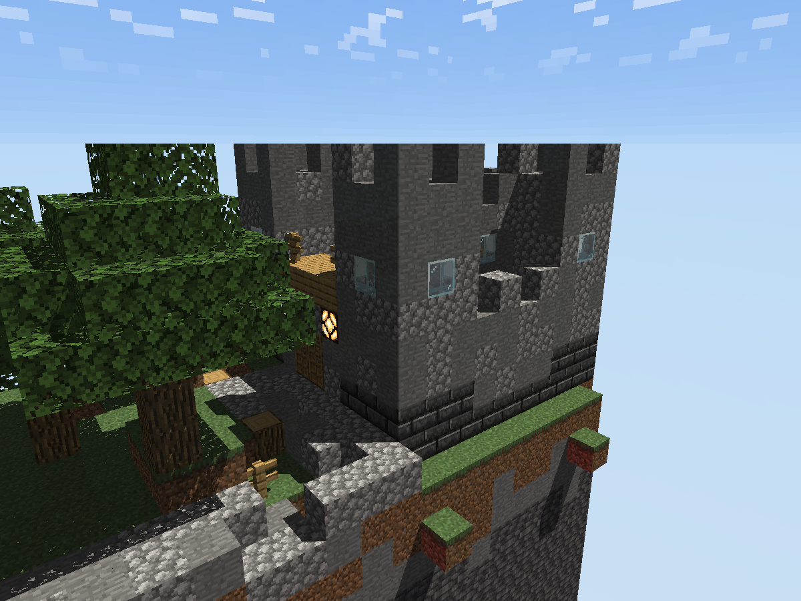</td>
<td width="50%">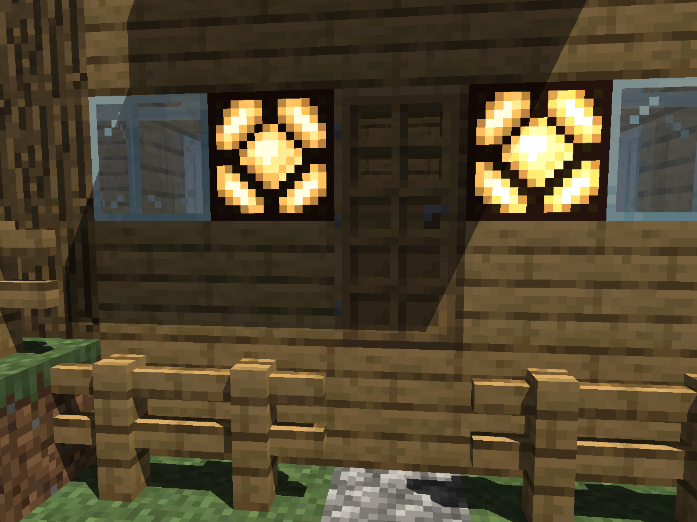</td>
</tr>
<tr>
<td>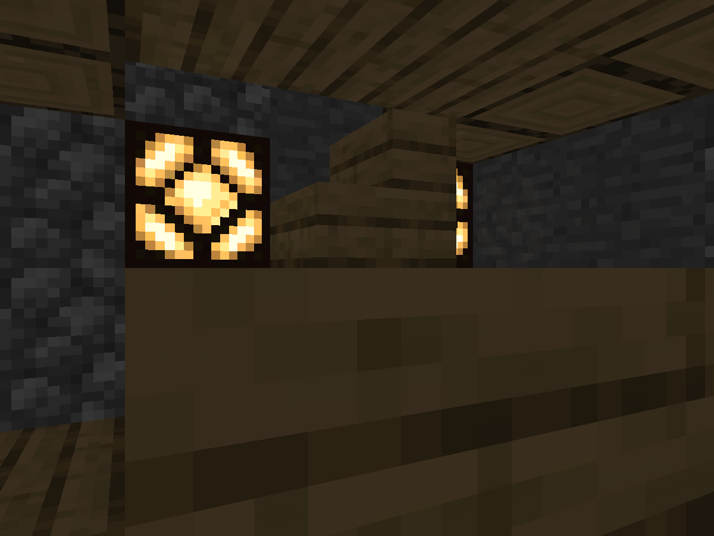</td>
<td>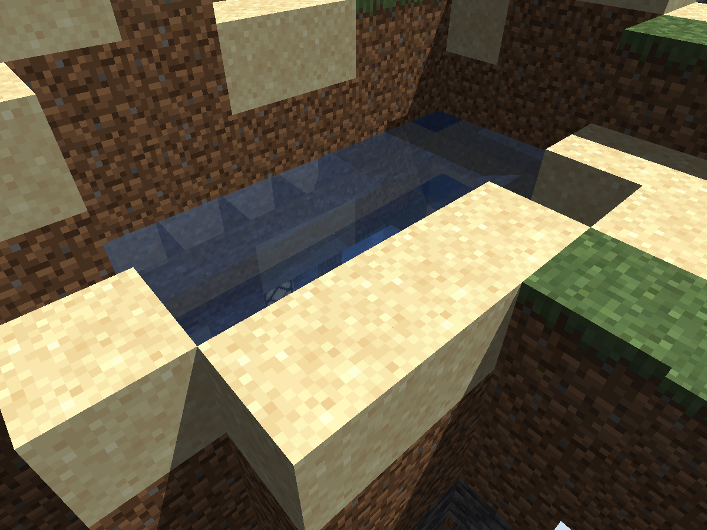</td>
</tr>
</table>

### Cruza el portal

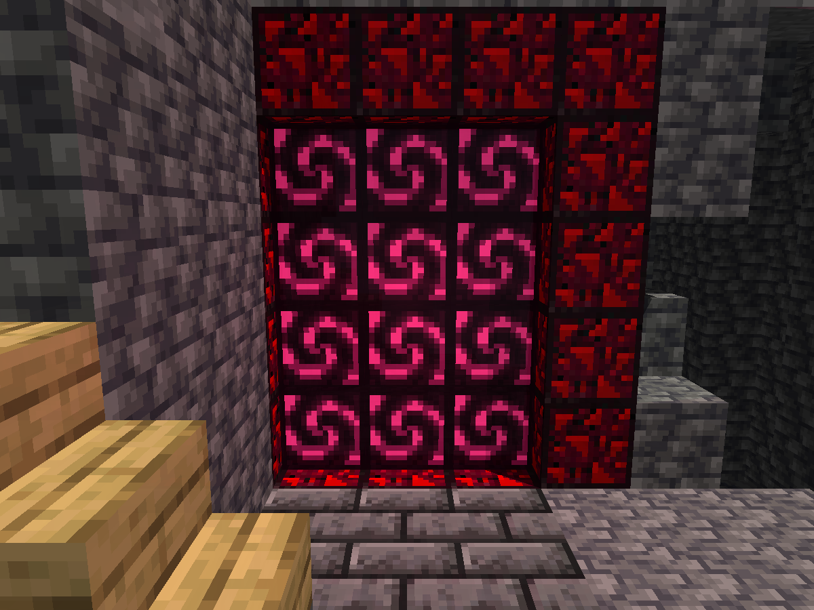

Una escalera desciende por el corte hasta un rellano de ladrillo. Frente a él se alza el portal:
un marco de obsidiana roja alrededor de un núcleo en espiral que emite su propia luz y tiñe la
piedra que lo rodea.

Atraviesa el núcleo y comienza el cruce:

- la cámara **gira 180°** sobre su propio eje de visión;
- el "arriba" pasa a ser `-Y`, así que la cara inferior de la isla es ahora el suelo sobre tu cabeza;
- el cielo de día **se funde** con una noche cornalina llena de estrellas;
- los controles siguen siendo coherentes: adelante sigue siendo adelante.

Vuelve a cruzarlo y todo se deshace.

### Red-Black

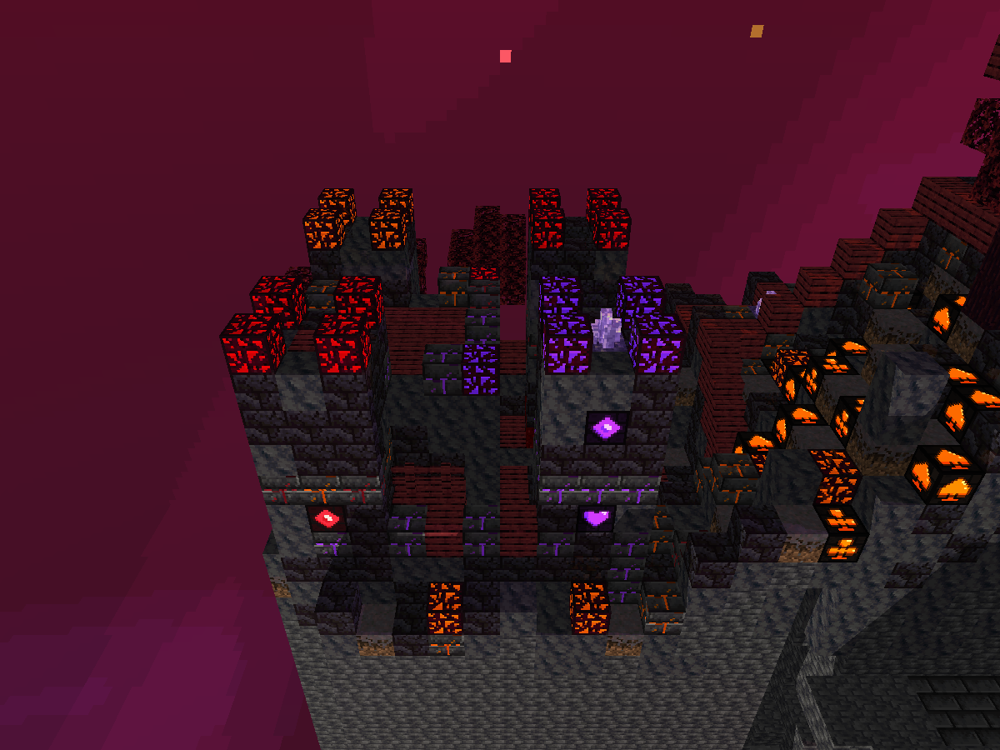

La mitad invertida. Aquí el mundo cuelga hacia abajo y su luz sale de los propios bloques.

- **Tres familias** — Crimson, Orange y Violet. Cada una ocupa una región de la cara inferior y
  tiene su propio juego de bloques luminosos con palos de la baraja: corazones, diamantes, tréboles
  y picas.
- **Fortaleza** — cuatro torres, una puerta fortificada con una hoja de madera corinto, un patio,
  una sala con trono y una escalera hacia un cuarto superior.
- **Aproximación** — un camino de tablones corinto desde el rellano del portal hasta la puerta.
- **Árboles carmesí** — troncos oscuros con follaje rojo, colgando hacia el cielo de abajo.
- **La casa** — la casa del Overworld reconstruida boca abajo en madera corinto, unida a la
  fortaleza por un camino de madera y un tramo de escaleras.
- **Piedra luminosa** — obsidiana llorosa en el color de cada familia y cúmulos de amatista.

<table>
<tr>
<td width="50%">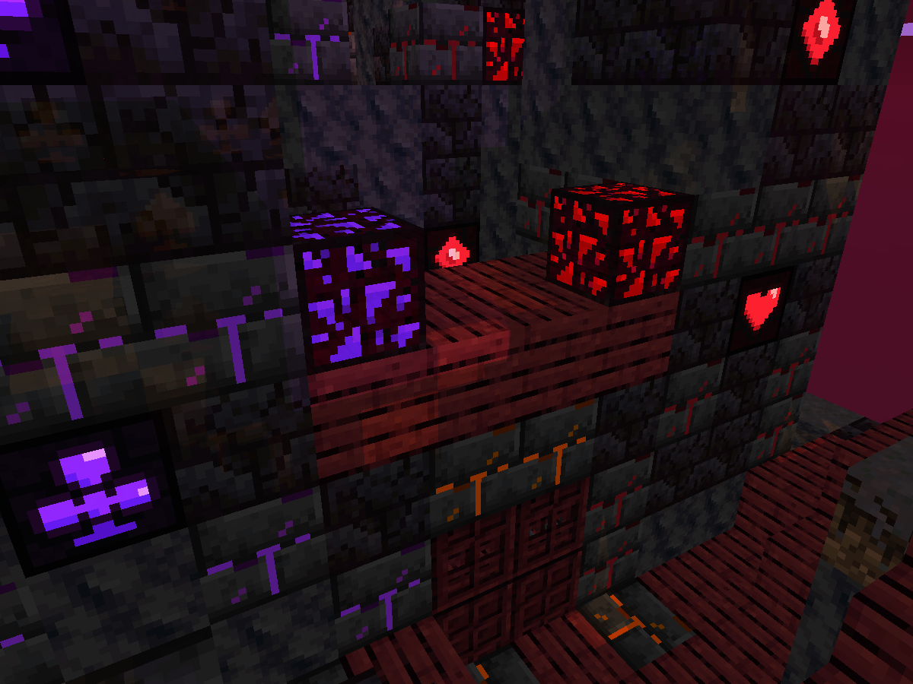</td>
<td width="50%">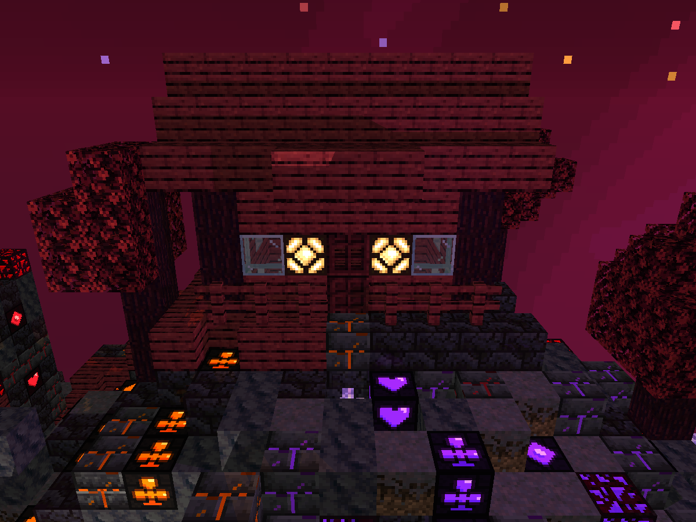</td>
</tr>
<tr>
<td>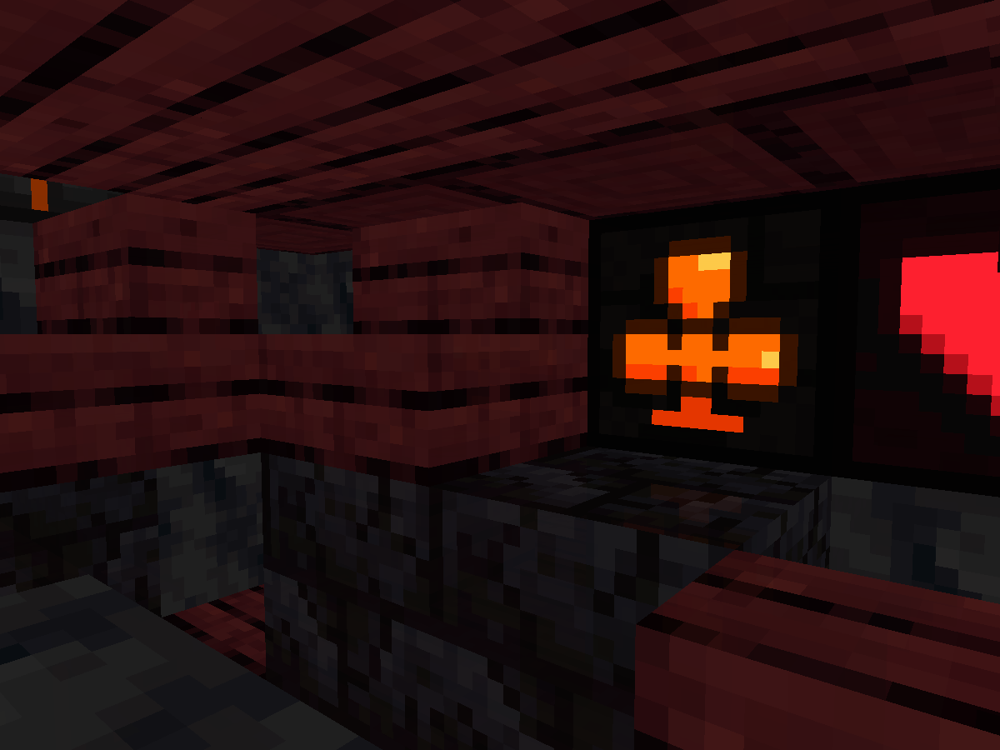</td>
<td>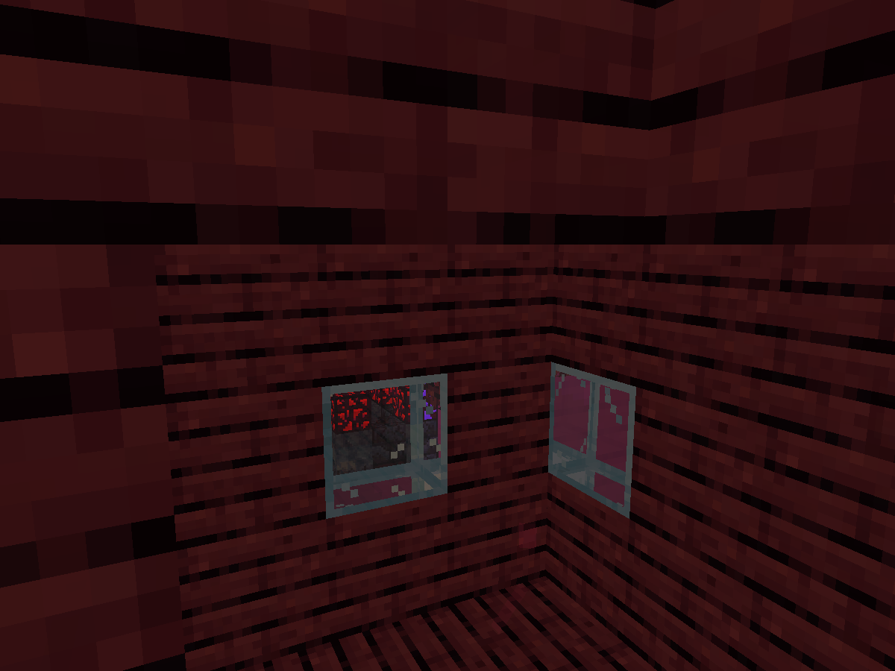</td>
</tr>
</table>

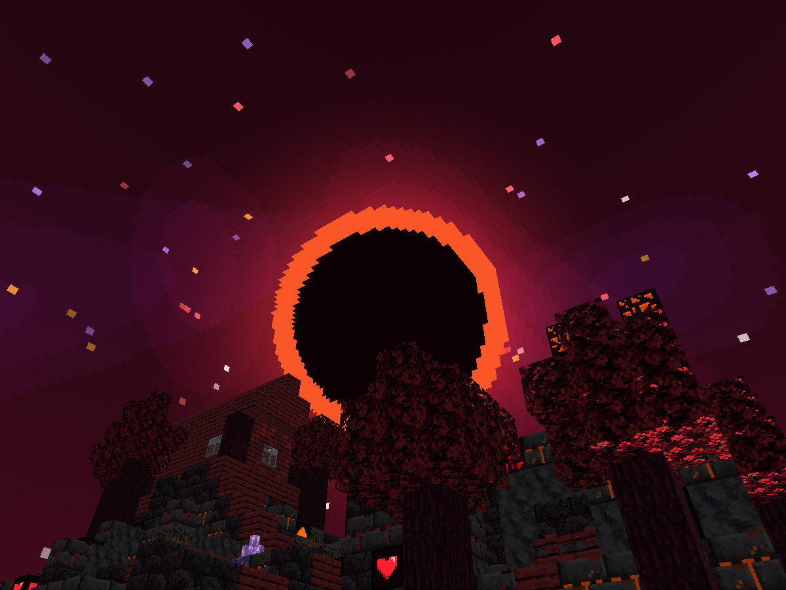

---

## Vista previa animada

Un recorrido grabado en la ventana real del proyecto: del Overworld al portal, la bajada por las
gradas corinto y el paseo por la fortaleza y la casa del mundo Red-Black.

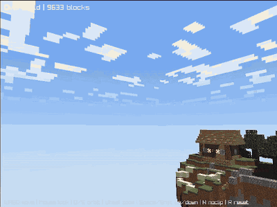

## Video final

El recorrido completo del diorama, con los dos mundos y el cruce del portal:

**[▶ Ver el video final](https://canva.link/74v72hppq7v0hwc)**

---

## Ejecuta el proyecto

Requiere una toolchain de Rust (edición 2024) y los paquetes del sistema necesarios para compilar
[raylib](https://github.com/raysan5/raylib) (un compilador de C y CMake).

```bash
# Explorar el mundo
cargo run --release

# Recorrer todos los bloques en el visor del catálogo
cargo run --bin catalog --release

# Ejecutar la suite de pruebas
cargo test
```

Usa `--release` para explorar. El ray tracer depende de la CPU, y las cifras de rendimiento de más
abajo se midieron con el build de release.

| Variable | Efecto |
|---|---|
| `RBRW_THREADS=<n>` | Número de workers de render (por defecto, todos los hilos de hardware) |
| `RBRW_PERF=1` | Imprime en la terminal el tiempo de render de cada frame |

---

## Controles

**Mundo** (`cargo run --release`)

| Entrada | Acción |
|---|---|
| `W` `A` `S` `D` | Volar hacia adelante, izquierda, atrás, derecha |
| Mouse | Mirar alrededor |
| `Q` / `E` | Orbitar la cámara alrededor del diorama |
| Rueda del mouse | Acercar y alejar a lo largo de la vista |
| `Space` / `Left Shift` | Subir / bajar |
| `N` | Activar o desactivar noclip (la colisión está activa por defecto) |
| `R` | Volver a la vista inicial |

El mouse queda capturado mientras el mundo está abierto; cierra la ventana para salir.

**Catálogo** (`cargo run --bin catalog --release`)

| Entrada | Acción |
|---|---|
| Arrastrar con clic izquierdo o flechas | Orbitar |
| Rueda del mouse | Zoom |
| `[` `]` o `Q` `E` | Seleccionar el bloque anterior / siguiente |
| `F` | Enfocar el bloque seleccionado |
| `R` | Restablecer la vista |

---

## Catálogo de bloques

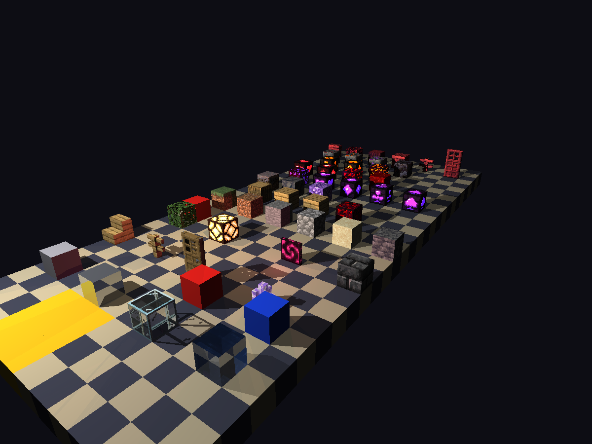

El mundo está construido con **45 bloques oficiales**, y los 45 aparecen en la escena final. El
visor del catálogo muestra cada uno por separado, con una cámara orbital, para inspeccionar su
textura, su forma y su material de forma aislada.

<details>
<summary><b>Terreno del Overworld</b> (9)</summary>

Grass · Dirt · Stone · Cobblestone · Sand · Water · Deepslate · Log · Leaves
</details>

<details>
<summary><b>Arquitectura del Overworld</b> (8)</summary>

Deepslate Bricks · Wood Planks · Double Wood Slab · Wood Stairs · Fence · Glass ·
Redstone Lamp (encendida) · Wood Door
</details>

<details>
<summary><b>Portal</b> (2)</summary>

Portal Frame (obsidiana roja) · Portal Core (carmesí oscuro)
</details>

<details>
<summary><b>Base Red-Black</b> (4)</summary>

Mycelium · Smooth Basalt · Budding Amethyst · Amethyst Cluster
</details>

<details>
<summary><b>Símbolos y familias Red-Black</b> (12)</summary>

**Crimson:** Crimson Heart · Crimson Diamond · Crying Obsidian (crimson) · Nether Wart Block<br>
**Orange:** Orange Club · Orange Spade · Crying Obsidian (orange)<br>
**Violet:** Purple Heart · Purple Diamond · Purple Club · Purple Spade · Crying Obsidian (violet)
</details>

<details>
<summary><b>Estructura Red-Black</b> (4)</summary>

Red-Black Deepslate Bricks (crimson, orange, violet) · Polished Blackstone Bricks
</details>

<details>
<summary><b>Orgánicos y madera Red-Black</b> (6)</summary>

Red-Black Leaves · Red-Black Log · Red-Black Wood Planks · Red-Black Fence ·
Red-Black Wood Door · Red-Black Wood Stairs
</details>

No todos los bloques son cubos. Las escaleras, las vallas, las puertas, el núcleo del portal y el
cúmulo de amatista se construyen con cajas más pequeñas y se intersecan de forma exacta.

---

## Materiales que transforman la luz

Cada material tiene su propia textura y sus propios parámetros ópticos. Estos siete muestran el
rango; los valores son los que usa el renderer.

| Material | Textura | Albedo (RGB) | Specular / shininess | Transparencia | Reflectividad | Efecto especial | Dónde verlo |
|---|---|---|---|---|---|---|---|
| **Water** | `overworld/water.png` | 0.20, 0.38, 0.75 | 0.55 / 80 | 0.78 | 0.18 | Refracción, índice 1.33 | El estanque |
| **Glass** | `overworld/glass.png` | 0.92, 0.97, 1.00 | 0.75 / 140 | 0.92 | 0.10 | Refracción, índice 1.50; marco opaco por el alfa de la textura | Ventanas de la casa, el castillo y la casa Red-Black |
| **Deepslate Bricks** | `deepslate_bricks/albedo.png` | 0.25, 0.25, 0.25 | 0.08 / 14 | 0 | 0.02 | Normal map | Base del castillo, rellano del portal |
| **Redstone Lamp** | `redstone_lamp/albedo.png` | 0.45, 0.35, 0.25 | 0.10 / 20 | 0 | 0 | Máscara emisiva, intensidad 1.8 | Junto a cada puerta |
| **Portal Core** | `portal/core_albedo.png` | 0.42, 0.05, 0.18 | 0.12 / 30 | 0.25 | 0.03 | Máscara emisiva, intensidad 2.5 | El portal |
| **Crying Obsidian** | `crying_obsidian/<family>_albedo.png` | 0.30, 0.03, 0.07 | 0.30 / 60 | 0 | 0.12 | Reflectante, vetas emisivas (1.4) | Torres de la fortaleza |
| **Amethyst Cluster** | `amethyst_cluster.png` | 0.58, 0.40, 0.82 | 0.65 / 110 | 0.08 | 0.20 | Reflectante, refractivo (1.45), emisivo (0.6) | A lo largo de los caminos Red-Black |

<table>
<tr>
<td width="50%">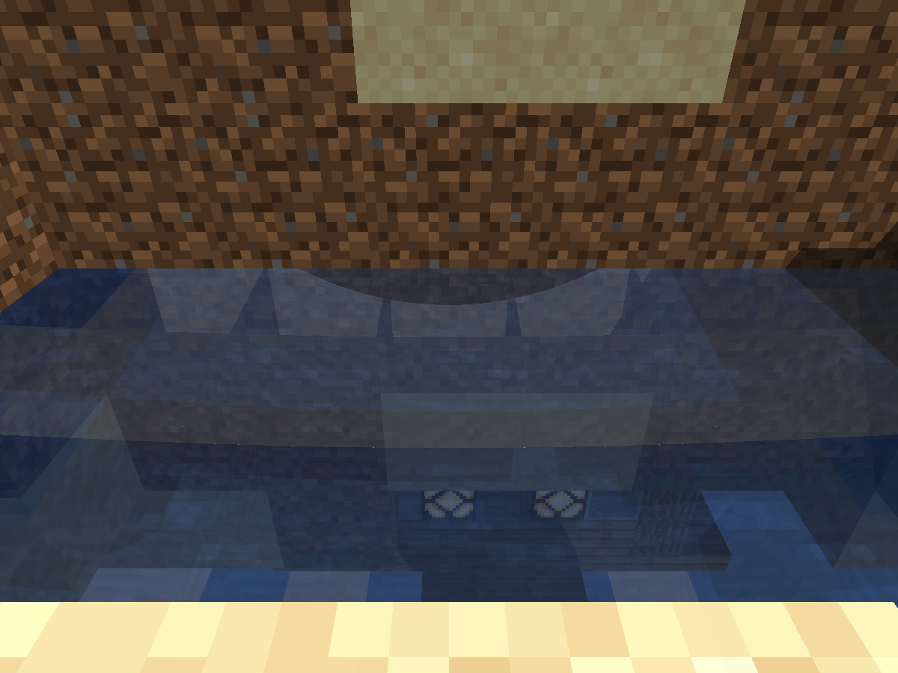</td>
<td width="50%">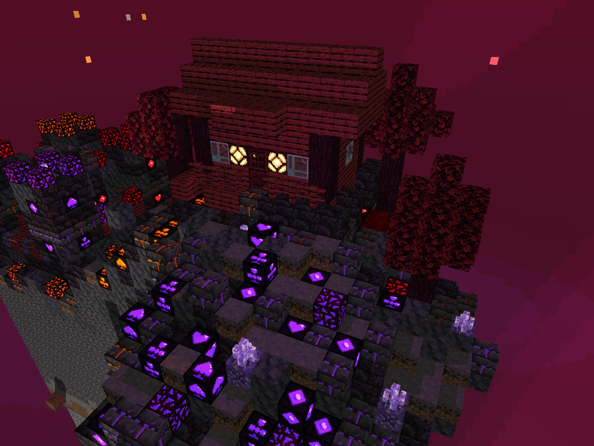</td>
</tr>
<tr>
<td><b>Refracción y reflexión.</b> A ras del agua, la pared del fondo del estanque se curva a través de la superficie y las lámparas de la casa se reflejan en ella.</td>
<td><b>Emisión.</b> Los símbolos de la baraja, la obsidiana llorosa y la amatista iluminan el mundo Red-Black desde dentro.</td>
</tr>
</table>

---

## El ray tracer por dentro

El renderer es un ray tracer clásico estilo Whitted, especializado en una cuadrícula de voxels.

| Etapa | Qué ocurre |
|---|---|
| **Rayos de cámara** | Un primary ray por píxel desde una cámara pinhole (campo de visión de 60°) |
| **Recorrido de voxels** | Un DDA 3D recorre la cuadrícula celda por celda; antes, cada rayo se recorta a los límites del mundo |
| **Intersección** | Cubos completos o las cajas exactas de una forma parcial (escalera, valla, puerta, cúmulo) |
| **Texturizado** | Texturas por cara, muestreo nearest-neighbor para mantener nítido el pixel art |
| **Difuso y specular** | Lambert más un brillo Phong, por cada luz |
| **Sombras** | Un rayo de sombra por luz; los texels recortados y los bloques transparentes dejan pasar la luz |
| **Reflexión** | Un rayo espejo ponderado por la reflectividad del material |
| **Refracción** | Ley de Snell con reflexión interna total, para el agua, el vidrio y la amatista |
| **Normal mapping** | Una textura de normales en espacio tangente perturba la normal de sombreado |
| **Emisión** | Una máscara emisiva añade la luz que la propia superficie desprende |
| **Transparencia** | Transparencia escalar, mezcla alfa por texel y recorte por alfa |
| **Skybox** | Los rayos que no golpean nada muestrean un cubemap de seis caras según su dirección |

Los secondary rays recursan hasta una profundidad de 3.

### Normal map: activado y desactivado

La misma vista del rellano de ladrillo del portal, iluminado por el portal. Solo cambia el normal map.

<table>
<tr>
<td width="50%">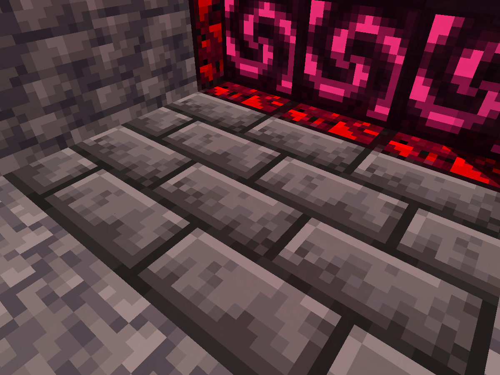</td>
<td width="50%">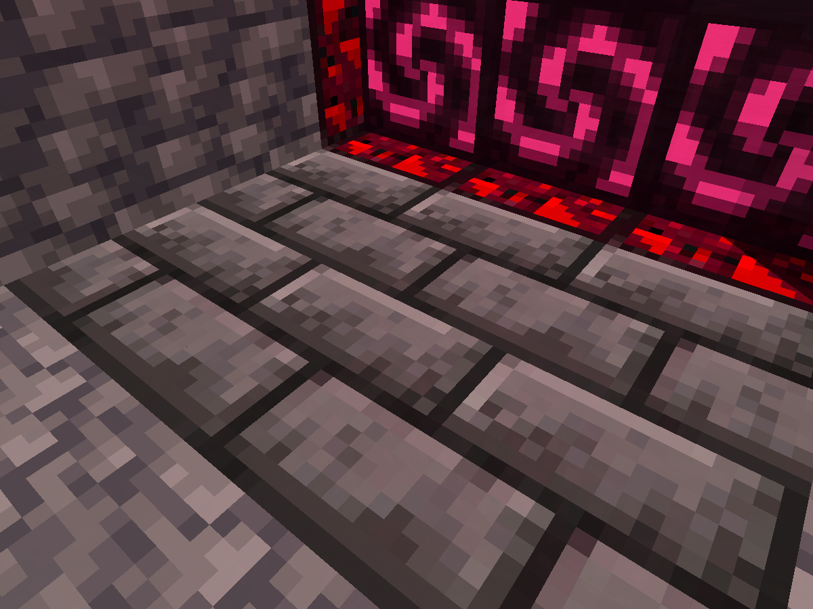</td>
</tr>
<tr>
<td align="center">Normal map desactivado (render de comparación)</td>
<td align="center">Normal map activado (la escena entregada)</td>
</tr>
</table>

Con el mapa, el bisel de cada ladrillo atrapa la luz del portal y las juntas caen en sombra.

### Skybox

El cielo es un cubemap real: seis imágenes de 128×128 por mundo, muestreadas en la CPU según la
dirección de cada rayo que sale del mundo. Las reflexiones y refracciones también lo ven.

- **Overworld** — nubes en bloques sobre un degradado azul, con un sol cuadrado colocado justo
  donde nace la luz direccional de la escena.
- **Red-Black** — estrellas en los colores de las tres familias, lentas bandas de nebulosa y una
  luna eclipsada.

El cubo se orienta según el "arriba" de cada mundo, así que gira con la cámara al cruzar el
portal, y los dos cielos se funden durante el giro.

---

## Terreno procedural

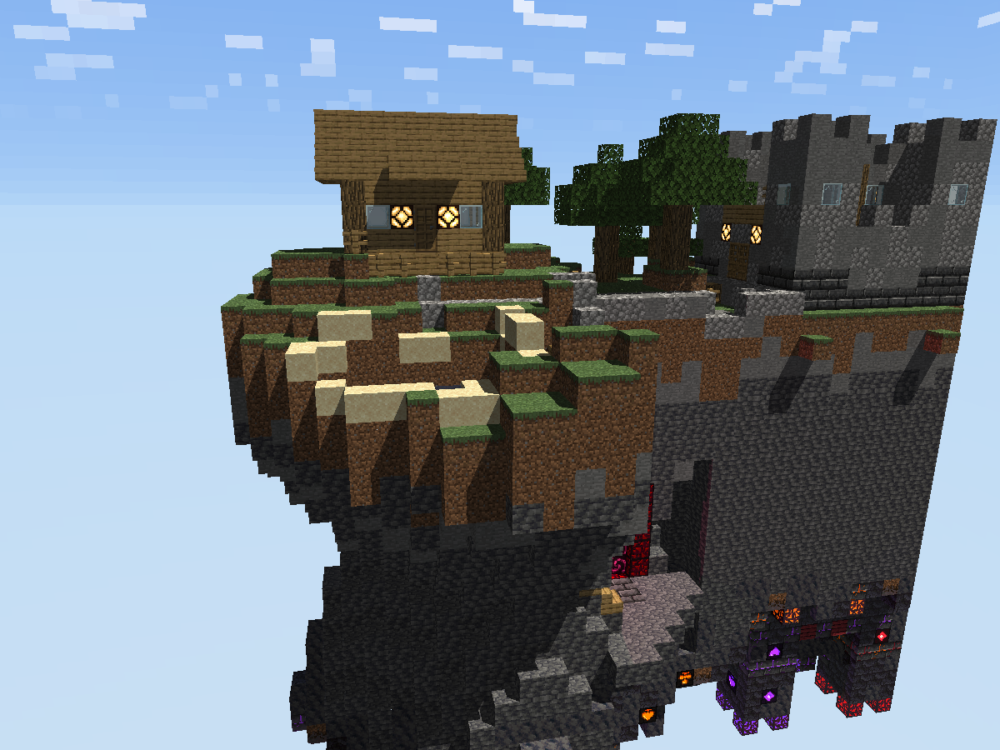

El terreno del Overworld se genera; no está colocado a mano.

| | |
|---|---|
| Área | **24 × 24 columnas** (576 columnas; la tarea pide al menos 16 × 16) |
| Algoritmo | Fractional Brownian motion (fBM) sobre value noise 2D |
| Octavas | 4, con lacunaridad 2.0 y ganancia 0.5 |
| Longitud de onda base | Unos 10 bloques, así que una colina abarca varias columnas |
| Mapeo de altura | Altura base 4, amplitud 3 |
| Estratos | Pasto arriba, 3 capas de tierra, luego piedra y deepslate desde `y = -1` hacia abajo |
| Determinismo | Hash entero con semilla: la misma semilla construye siempre la misma isla |

El ruido decide la altura de cada columna; los estratos se rellenan desde esa altura hacia abajo.
Después, el estanque, el terreno de la casa y los caminos se tallan y nivelan sobre el relieve
generado. La base afilada de la isla y su lóbulo de 13 × 12 para el castillo prolongan la misma
masa.

---

## De segundos por frame a un mundo explorable

Una versión ingenua de este renderer tardaba segundos por frame. Estos son los pasos que lo
volvieron interactivo.

- **World-bounds clipping** — cada rayo se recorta a la caja que envuelve el mundo antes de que
  empiece el DDA, así que los rayos al cielo casi no cuestan.
- **Multithreading** — el frame se divide en bandas de filas que trazan workers `std::thread` con
  scope, uno por hilo de hardware (`available_parallelism`).
- **Dos calidades** — *Interactive* omite el rebote especular en materiales apenas reflectantes;
  *Full* lo traza todo.
- **Vista previa adaptativa** — mientras la cámara se mueve, el frame se traza a la mitad o a un
  cuarto de resolución, según el tiempo de render medido frente a un presupuesto de 50 ms.
- **Refinamiento cancelable** — cuando la cámara se detiene, se traza un frame Full a resolución
  completa en pequeños lotes entre lecturas de entrada; cualquier movimiento lo cancela al instante.
- **Reutilización de buffers** — el framebuffer y la textura de presentación se reservan una sola
  vez y se actualizan en el sitio.

### Rendimiento medido

Build de release, 20 hilos de trabajo, calidad Interactive a 400×300 (la vista previa con la cámara
en movimiento).

| Escenario | Tiempo de render | Frame rate |
|---|---|---|
| Diorama completo (vista inicial) | 26.7 ms | 36 FPS |
| Overworld con el lóbulo del castillo | 28.1 ms | 35 FPS |
| Castillo del Overworld, exterior | 19.7 ms | 48 FPS |
| Castillo del Overworld, interior | 19.9 ms | 49 FPS |
| Portal y corte | 49.3 ms | 20 FPS |
| Justo después de cruzar | 24.9 ms | 39 FPS |
| Red-Black, vista amplia | 44.1 ms | 22 FPS |
| Aproximación a la fortaleza | 34.9 ms | 28 FPS |
| Fortaleza, exterior | 29.8 ms | 32 FPS |
| Fortaleza, interior | 20.9 ms | 46 FPS |
| Arboleda Red-Black | 28.8 ms | 34 FPS |

Todos los escenarios se mantienen por encima del mínimo de 15 FPS que se fijó el proyecto. Un
frame en calidad Full de las mismas vistas tarda entre 93 ms y 373 ms. El benchmark forma parte de
la suite de pruebas:

```bash
cargo test --release --test gate17_5_red_black_identity_closure_tests bench_release_identity -- --ignored --nocapture
```

---

## Cobertura de la rúbrica

| Criterio | Puntos | Implementación | Evidencia visible | Estado |
|---|---|---|---|---|
| Complejidad de la escena | 20 | Dos mundos en un solo mundo de voxels, un portal, un castillo, una fortaleza, dos casas, interiores, caminos, árboles, 45 tipos de bloque | [Portada](docs/screenshots/readme/01-hero-world.png), [los dos mundos](docs/screenshots/readme/14-two-worlds.png) | Cubierto |
| Atractivo visual | 15 | Mundos de día y de noche en contraste, iluminación emisiva Red-Black, cielos cubemap | [Overworld](docs/screenshots/readme/02-overworld.png), [eclipse](docs/screenshots/readme/17-skybox-night.png) | Cubierto |
| Programación paralela y optimización | 10 | Hilos con scope sobre bandas de filas, recorte a los límites, vista previa adaptativa, refinamiento cancelable | [Tabla de rendimiento](#rendimiento-medido) | Cubierto |
| Rotación y zoom de cámara | 10 | Órbita con `Q`/`E` alrededor del diorama, vista con el mouse, zoom con la rueda, acercamiento con `W`/`S` | [Controles](#controles) | Cubierto |
| Cinco materiales distintos | 25 (5 × 5) | Siete documentados, cada uno con su textura, albedo, specular, transparencia y reflectividad | [Tabla de materiales](#materiales-que-transforman-la-luz) | Cubierto |
| Refracción | 10 | Refracción de Snell en el agua (1.33) y el vidrio (1.50) | [Estanque](docs/screenshots/readme/06-water-refraction.png), [ventanas](docs/screenshots/readme/18-house-glass.png) | Cubierto |
| Reflexión | 5 | Rayos espejo en el agua, el vidrio, la obsidiana llorosa y la amatista | [Estanque](docs/screenshots/readme/06-water-refraction.png) | Cubierto |
| Normal maps | 10 | Normal map en espacio tangente sobre Deepslate Bricks y los tres ladrillos Red-Black | [Activado / desactivado](#normal-map-activado-y-desactivado) | Cubierto |
| Material emisivo | 10 | Máscaras emisivas en las lámparas, el núcleo del portal, 8 bloques de palos, la obsidiana llorosa y la amatista | [Cara inferior](docs/screenshots/readme/11-emissive-materials.png), [portal](docs/screenshots/readme/07-portal.png) | Cubierto |
| Skybox | 10 | Cubemap de seis caras por mundo, muestreado en la CPU según la dirección del rayo | [Día](docs/screenshots/readme/16-skybox-day.png), [noche](docs/screenshots/readme/17-skybox-night.png) | Cubierto |
| Terreno procedural (≥ 16 × 16) | 20 | 24 × 24 columnas de value noise fBM de 4 octavas con estratos | [Terreno](docs/screenshots/readme/05-procedural-terrain.png) | Cubierto |

Los criterios publicados suman 145 puntos y la nota máxima de la tarea es 100, así que la lista
ofrece más formas de sumar puntos de las necesarias.

### Requisitos de entrega

| Requisito | Evidencia | Estado |
|---|---|---|
| Entrega en GitHub | Este repositorio | Listo |
| Video del diorama en el README | [Video final](#video-final) | Listo |
| Sin librerías externas al lenguaje | Raylib 5.5 es la única dependencia externa directa. Abre la ventana, lee la entrada, decodifica los PNG y muestra el frame terminado; no participa en el ray tracing. Ver [Política de dependencias](#política-de-dependencias). | Cumplido bajo la autorización específica del profesor: Raylib 5.5 se utiliza únicamente como infraestructura y no implementa ninguna de las características evaluadas del ray tracing |
| Sin uso de la tarjeta de video | Rayos, recorrido, intersecciones, sombreado, sombras, reflexión, refracción, normal maps, emisión y skybox se calculan en la CPU. Después, Raylib sube la imagen terminada como una textura para mostrarla. | La tarjeta gráfica no se usa para los cálculos evaluados del ray tracing; solo interviene en la presentación del frame final a través de Raylib |
| Funcionalidades visibles y usadas con intención | Cada funcionalidad de arriba tiene un lugar en la escena y una captura | Listo |

---

## Arquitectura y decisiones de ingeniería

```text
 input ──► camera ──► primary rays ──► 3D DDA ──► intersection ──► shading ──► framebuffer ──► window
            │                            │             │              │
            │                        VoxelWorld    block shape     material, lights,
       free-fly, collision,          (one grid,    (cube or        shadows, reflection,
       portal crossing               two realms)   boxes)          refraction, normal map,
                                                                   emission, skybox
```

El código se divide en cuatro capas, y cada una depende solo de las anteriores.

| Capa | Contenido |
|---|---|
| `core` | `Vec3`, `Ray`, `HitRecord`, `Aabb`, intersección de `Cube` y `Prism`, `Color`, `Material`, `CpuTexture`, matemática de reflexión y refracción |
| `scene` | `VoxelWorld`, `BlockType`, formas de bloque, la biblioteca de materiales, las luces, el generador de terreno y los constructores de cada estructura |
| `camera` | `Camera` y la proyección de rayos, la cámara free-fly del mundo, la colisión, el cruce del portal y la cámara orbital del catálogo |
| `renderer` | El ray tracer, el recorrido DDA 3D, el sombreado, las sombras, el normal mapping, la emisión, el skybox, el render paralelo, la vista previa adaptativa, el refinamiento y el `Framebuffer` |

`app.rs` es el único archivo que habla con raylib: lee la entrada, le pide un frame al renderer y
presenta el framebuffer.

### Cómo se construye un frame

1. **La entrada** mueve la cámara free-fly; el movimiento se resuelve contra los bloques sólidos.
2. **El detector del portal** comprueba si ese movimiento atravesó la membrana del portal.
3. **El renderer paralelo** divide la imagen en bandas de filas y las reparte entre los hilos.
4. **Cada píxel** lanza un primary ray, que el DDA 3D recorre a través de `VoxelWorld`.
5. **Cada impacto** se sombrea: textura, luces, rayos de sombra y luego rayos de reflexión y refracción.
6. **El framebuffer** se copia en una textura y se dibuja en la ventana.

### Política de dependencias

**Raylib 5.5 es la única dependencia externa directa del proyecto:**

```toml
raylib = "5.5"
```

La tarea establece que no se pueden usar librerías externas al lenguaje de programación. El uso
limitado de Raylib fue autorizado explícitamente por el profesor para este proyecto, con la
condición de que la biblioteca no hiciera el trabajo evaluado.

El profesor autorizó Raylib como infraestructura para crear la ventana, leer las entradas, cargar
recursos y presentar en pantalla el framebuffer generado por la CPU. Toda la funcionalidad evaluada
de ray tracing —matemática vectorial, generación de rayos, intersecciones, recorrido de voxels
mediante DDA 3D, coordenadas UV, materiales, iluminación, sombras, reflexión, refracción, normal
maps, emisión, generación procedural del terreno y paralelismo— está implementada a mano en Rust y
se ejecuta en la CPU. Raylib no se utiliza para construir ni para renderizar la escena 3D.

| Raylib se usa para | Raylib no se usa para |
|---|---|
| Crear la ventana | Ray casting ni ray tracing |
| Leer teclado y mouse | Recorrido DDA ni intersecciones |
| Cargar y decodificar los PNG usados como recursos | Iluminación, sombras, reflexión ni refracción |
| Presentar el framebuffer final calculado en la CPU | Normal maps ni emisión |
| Dibujar el texto 2D del HUD | Terreno procedural, geometría de voxels ni el render paralelo |

**Sin el pipeline 3D de Raylib.** La escena no usa `Camera3D`, `BeginMode3D`, `DrawCube`,
`DrawModel`, `Mesh` ni `Shader`. El mundo lo calcula el ray tracer propio en la CPU y después se
presenta el framebuffer.

**Sobre la GPU.** Todo el cálculo del ray tracing se ejecuta en la CPU. Raylib se limita a
gestionar la ventana, las entradas, los recursos y la presentación del framebuffer final, y para
mostrar esa imagen puede apoyarse internamente en la tarjeta gráfica; la GPU no realiza ninguno de
los cálculos evaluados.

**Dependencias directas y transitivas.** `Cargo.lock` contiene además crates transitivos que
Raylib necesita para compilarse. No son dependencias de implementación: el proyecto no usa crates
externos para vectores, álgebra, ray tracing, procesamiento de imágenes del renderer, generación de
ruido, threading, física ni render 3D.

### Decisiones que vale la pena explicar

- **Por qué la CPU.** La tarea trata sobre el ray tracing en sí. Hacerlo en la CPU deja cada paso
  en Rust simple que se puede leer y probar: la suite verifica rayos individuales y píxeles
  individuales.
- **Por qué un solo `VoxelWorld`.** Los dos mundos son la misma isla. Una sola cuadrícula hace que
  el portal sea una abertura real, que el corte muestre las dos mitades a la vez y que la luz y los
  reflejos pasen de una a otra sin casos especiales.
- **Por qué un portal físico.** Un teletransporte escondería el truco. Atravesar un agujero de
  verdad y ver cómo el mundo se da la vuelta es el sentido de la escena.
- **Por qué Red-Black usa `-Y`.** El segundo mundo es la cara inferior del primero, así que su
  suelo es el techo de la isla. Todo allí se construye con el "arriba" apuntando hacia abajo: los
  bloques se orientan hacia abajo, las escaleras suben hacia `-Y` y los controles de la cámara lo
  siguen.
- **Por qué muestreo nearest-neighbor.** Las texturas son pixel art de 16 × 16. Filtrarlas las
  difuminaría; nearest-neighbor mantiene cada texel como un cuadrado limpio.
- **Por qué la emisión no siempre crea luces.** Un bloque emisivo brilla por sí mismo, pero
  convertirlos a todos en fuentes de luz exigiría un rayo de sombra por bloque y por píxel. Solo
  existen cinco luces reales; el resto son máscaras emisivas, y eso es lo que mantiene explorable
  el mundo.
- **Por qué los símbolos usan máscaras.** Un bloque de palo es una sola textura con una máscara
  emisiva sobre el símbolo, así que el corazón brilla mientras su marco sigue oscuro.
- **Por qué Mundo y Catálogo están separados.** El catálogo es un estudio neutro para inspeccionar
  un bloque a la vez; el mundo es la escena compuesta. Comparten el renderer y nada más.
- **Por qué conviven colisión y noclip.** La colisión hace que los caminos, las puertas y los
  interiores se sientan como lugares. El noclip existe para inspeccionar y para grabar tomas desde
  fuera.
- **Por qué las formas parciales son cajas.** Las escaleras, vallas y puertas son unas pocas cajas
  alineadas con los ejes, así que reutilizan la intersección del cubo y se mantienen exactas.

---

## Pruebas y validación

```bash
cargo fmt -- --check
cargo check
cargo test --no-fail-fast
cargo check --bin catalog
```

La suite contiene 1,932 pruebas en más de 200 archivos de prueba. Cubren la matemática, las
intersecciones de rayos individuales, los pasos del DDA, la óptica de los materiales, el skybox,
cada estructura de los dos mundos, la colisión y recorridos completos de la ruta que va de la casa
al cuarto superior de la fortaleza y de vuelta.

Las capturas de este README las renderizó el propio ray tracer del proyecto a 1200 × 900 en
calidad Full, sin HUD, y no se editaron después.

---

## Estado final del proyecto

| | |
|---|---|
| Mundo | Completo: Overworld, portal y mundo Red-Black |
| Catálogo | 45 de 45 bloques oficiales |
| Pruebas | 1,932 superadas, 0 fallidas |
| Vista previa animada | [GIF del recorrido](#vista-previa-animada) |
| Video final | [Ver el video](https://canva.link/74v72hppq7v0hwc) |

Hecho con Rust. Raylib 5.5 es la única dependencia externa directa y se usa para la ventana, la
entrada, la decodificación de PNG y la presentación del frame terminado, con autorización del
profesor.
